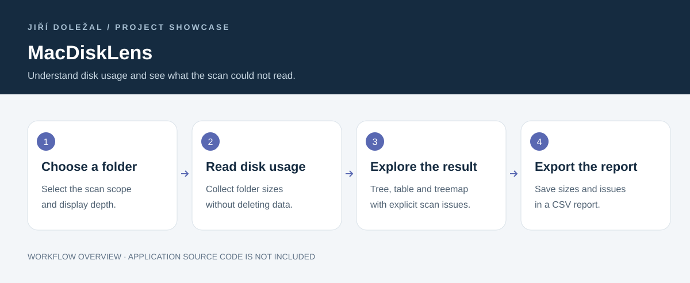

# MacDiskLens

**Přehled zaplnění disku v macOS včetně míst, která nebylo možné přečíst.**

[Ukázkový report](demo/sample-scan.csv) · [English](README.md) · [Všechny projekty](https://github.com/Dolik64)

*Schéma pracovního postupu, nikoli screenshot aplikace.*

## O projektu

Grafický analyzátor zaplnění disku pro macOS. Zobrazuje velikosti složek ve stromu, tabulce a interaktivní treemapě. Chyby oprávnění neskrývá a neúplný výsledek výslovně označuje. Dokumentovaná verze je **0.1.0** a pracuje pouze pro čtení.

## Hlavní funkce

- Sken vybrané složky systémovou utilitou pro měření velikostí.
- Volba hloubky zobrazení a procházení výsledků.
- Otevření vybraného umístění ve Finderu.
- Seznam nepřístupných cest a chyb skenu.
- Přehled lokálních Time Machine a APFS snapshotů.
- Porovnání nalezených dat s informacemi o svazku.
- Export velikostí a problémů do CSV.

**Technologie:** Java 17+, Swing, systémové utility macOS, CSV, treemap vizualizace.

## Ukázka a omezení

[Demonstrační CSV](demo/sample-scan.csv) zachovává sloupce reportu, ale používá smyšlené cesty a velikosti. Nejde o sken skutečného disku ani nový výsledek testování aplikace. [Průvodce](docs/demo.md) vysvětluje označení neúplnosti a sekci chyb.

Ochrany macOS mohou blokovat některá data i při zvýšených oprávněních. Snapshoty, sdílené bloky a metadata mohou přispívat k rozdílu oproti údajům svazku. Takový rozdíl automaticky neznamená prostor vhodný ke smazání.

Repozitář obsahuje pouze prezentaci a syntetická data. Zdrojový kód, spustitelná aplikace ani skutečné výpisy disku zde nejsou.
