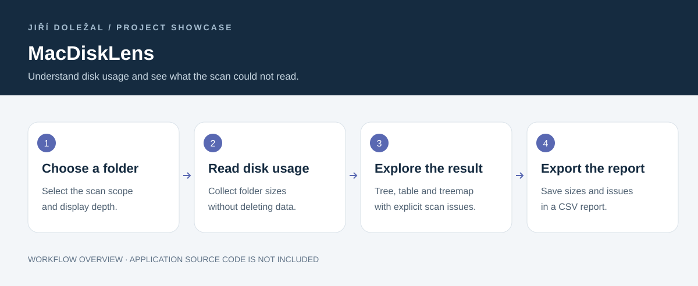

# MacDiskLens

**Understand disk usage on macOS, including the places a scan could not read.**

[Demo scenario](docs/demo.md) · [Sample report](demo/sample-scan.csv) · [Česky](README.cs.md) · [All my projects](https://github.com/Dolik64)

*Workflow diagram, not a screenshot of the application.*

## The project

MacDiskLens is a read-only graphical disk usage analyser for macOS. It displays folder sizes in a tree, a table and an interactive treemap, and reports permission or scan problems instead of hiding them.

The documented application version is **0.1.0**. Its purpose is to inspect storage, not delete files.

## What it does

- Scan a selected folder using the system disk usage utility.
- Choose a display depth and explore folders through a tree, table and treemap.
- Open a selected location in Finder.
- Display inaccessible paths and mark incomplete scan results.
- List local Time Machine and APFS snapshots.
- Compare discovered data with volume information.
- Export folder sizes and scan issues to CSV.

## Technical focus

**Java 17+ · Swing · macOS system utilities · CSV · Treemap visualisation**

The project brings filesystem inspection into a desktop interface and makes scan completeness explicit. It distinguishes a measured folder size from a claim that the entire volume was readable.

## Demo material

The [sample CSV](demo/sample-scan.csv) uses the report's column structure with synthetic paths and sizes. The [demo guide](docs/demo.md) explains how to interpret its incomplete result and issue section.

The sample was prepared for this showcase. It is not a scan of a real user's disk or a new application test result.

## Limits that matter

macOS protections can leave data inaccessible even with elevated privileges. APFS snapshots, shared blocks, metadata and other volumes can contribute to differences between discovered files and volume totals. A difference is not automatically reclaimable space.

This repository contains presentation material and synthetic data only. The application source, executable and real filesystem reports are not included.
